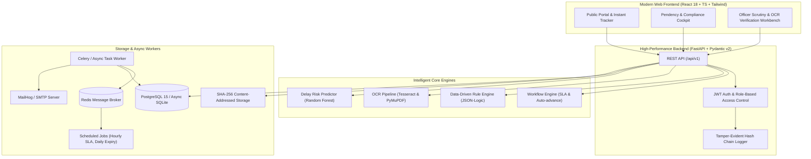

# ApprovalTrack (AICTE Approval Workflow Automation, Compliance Monitoring & Alert Management System)

> **Smart India Hackathon 2026**
> **Problem Statement ID:** SIH26262  
> **Theme:** Smart Automation | **Category:** Software  
> **Team:** Tech Spark  

---

## 1. Executive Summary

Approval of technical institutions (Engineering, Polytechnic, Management, Pharmacy, Architecture) by the All India Council for Technical Education (AICTE) has traditionally relied on heavy manual tracking. Regulatory officials struggle to maintain real-time visibility over pending files, designated scrutiny officers, stage delays, unfulfilled compliance conditions, expiring land leases and fire NOCs, and upcoming Expert Visit Committee (EVC) peer reviews.

**ApprovalTrack** solves this with a unified, automated regulatory intelligence platform:
- **Autonomous Stage Progression**: Automatically moves applications forward once prerequisites (verified documents, zero open deficiencies) are fulfilled.
- **Real-Time Pendency Cockpit**: Interactive dashboard displaying all pending files, responsible desk officers, age buckets, and SLA breach timers.
- **OCR Document Engine**: Tesseract & PyMuPDF automated date, lease duration, and reference number extraction with human-in-the-loop verification.
- **Declarative Rule Engine**: AST JSON-logic evaluation of regulatory norms (e.g. 30-year land lease, fire NOC validity) with explainable pass/fail traces.
- **EVC Inspection Orchestration**: Availability checks, peer-review conflict-of-interest detection, structured digital reporting.
- **Multi-Tier Escalation Ladder**: Automated reminders (T-7, T-2, T-1) and automated escalations (Level 0 -> Level 1 -> Level 2) on SLA breach.
- **Machine Learning Delay Risk Scoring**: Scikit-learn predictive classifier flagging high-risk applications before deadlines are breached.
- **Tamper-Evident Hash-Chained Audit Trail**: Cryptographic SHA-256 chaining guaranteeing zero database tampering.

---

## 2. System Architecture



---

## 3. Demo Credentials (1-Click Login Ready)

| Role | Email | Password | Scope & Responsibilities |
|---|---|---|---|
| **Super Admin** | `admin@approvaltrack.test` | `ApprovalTrack@2026` | Global governance, workflow stage rules, system settings, user provisioning |
| **AICTE Officer** | `officer@approvaltrack.test` | `ApprovalTrack@2026` | Desk scrutiny, OCR verification, deficiency issuance, EVC scheduling |
| **Senior Officer** | `senior@approvaltrack.test` | `ApprovalTrack@2026` | Regional oversight, stage transitions, officer reassignments, escalations |
| **EVC Member** | `evc@approvaltrack.test` | `ApprovalTrack@2026` | Expert peer visits, conflict screening, digital visit reporting |
| **College Admin** | `college@approvaltrack.test` | `ApprovalTrack@2026` | Multi-step application submission, document uploads, deficiency resolution |
| **Auditor** | `auditor@approvaltrack.test` | `ApprovalTrack@2026` | Read-only analytics, cryptographic hash-chain integrity verification |

---

## 4. Quick Start (Single Command via Docker)

Ensure Docker and Docker Compose are installed:

```bash
docker compose up --build
```

### Endpoints:
- **Web Application**: [http://localhost:3000](http://localhost:3000)
- **Interactive OpenAPI Documentation**: [http://localhost:8000/docs](http://localhost:8000/docs)
- **MailHog Email Testing Interface**: [http://localhost:8025](http://localhost:8025)

---

## 5. Non-Docker Local Run Instructions

### Step 1: Backend Setup
```bash
cd backend
python -m venv venv

# Windows:
.\venv\Scripts\activate
# Linux/macOS:
source venv/bin/activate

pip install -r requirements.txt

# Run the realistic seed script (60+ institutions, 300+ applications):
python -m app.db.seed

# Train / verify the ML delay model:
python -m app.ml.train

# Start FastAPI server:
uvicorn app.main:app --host 0.0.0.0 --port 8000 --reload
```

### Step 2: Frontend Setup
```bash
cd frontend
npm install
npm run dev
```
Open [http://localhost:3000](http://localhost:3000) in your browser.

---

## 6. Project Documentation Suite

- [docs/ARCHITECTURE.md](docs/ARCHITECTURE.md) - System architecture and component interactions
- [docs/DB_SCHEMA.md](docs/DB_SCHEMA.md) - Normalized relational database schema with Mermaid ER diagram
- [docs/DECISIONS.md](docs/DECISIONS.md) - Architectural Decision Records (ADRs)
- [docs/SECURITY.md](docs/SECURITY.md) - Security controls, cryptographic hash chaining, and OWASP Top 10 mitigation
- [docs/API.md](docs/API.md) - Complete REST API specification
- [docs/USER_GUIDE.md](docs/USER_GUIDE.md) - Role-by-role user navigation guide
- [docs/DEPLOYMENT.md](docs/DEPLOYMENT.md) - Production deployment and hardening instructions
- [docs/DEMO_SCRIPT.md](docs/DEMO_SCRIPT.md) - Exact 5-minute SIH live jury presentation walkthrough

