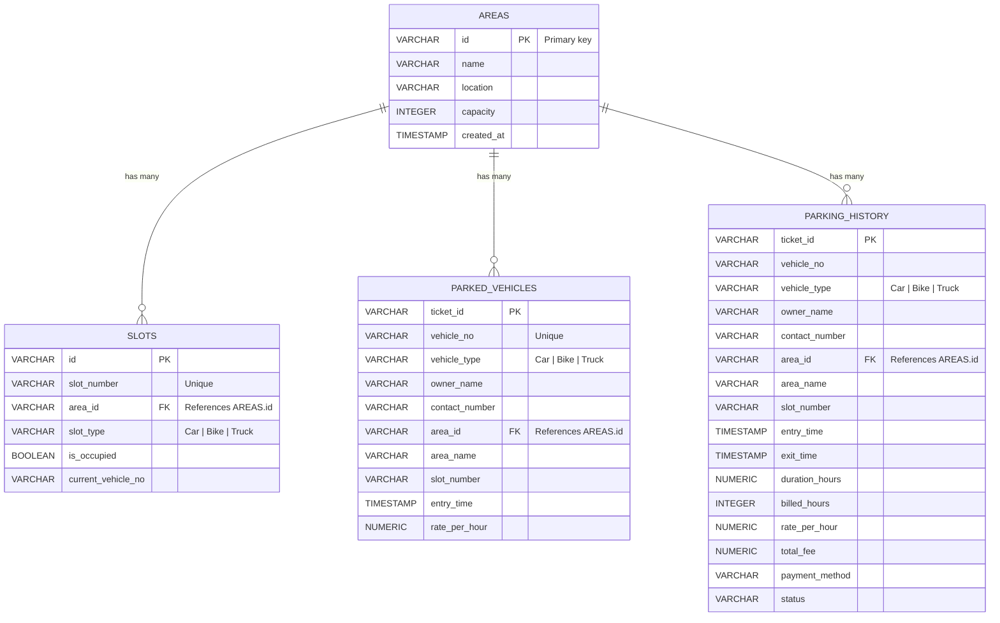

# Smart Parking Management System

**Live Demo:** https://dharanis11708-del.github.io/sih-project/parking/

**GitHub Repository:** https://github.com/dharanis11708-del/sih-project

---

## Overview

This project implements a **Smart Parking Management & Usage Analysis System** for a college campus. It is a single‑page web application built with vanilla HTML, CSS, and JavaScript (Chart.js) that runs entirely in the browser using `localStorage` for persistence. The UI provides:

- Real‑time dashboard with occupancy metrics
- Vehicle entry & exit workflows
- Interactive slot‑grid visualisation
- Parking area administration
- Detailed usage analytics (category breakdown, peak‑hour heatmap, daily revenue trend)
- CSV export of audit data

The backend is a lightweight Python HTTP server (optional) that can be used for future API integration, but the core UI works without any Node/NPM dependencies.

---

## Tech Stack

| Layer | Technology |
|-------|------------|
| Frontend | HTML5, CSS3 (custom design), JavaScript (ES6), Chart.js (bundled locally) |
| Data Store | `localStorage` (browser) – easily replaceable with a REST API |
| Backend (optional) | Python 3.11 – `python -m http.server` for static files or `server.py` for API mock |
| CI/CD | GitHub Pages for automatic deployment |

---

## Quick Start – Running Locally

### 1. Prerequisites

- **Windows** (your OS) with **Python 3.11+** installed and added to `PATH`.
- No Node.js or npm is required for the frontend.

### 2. Clone the Repository (if not already present)

```bash
git clone https://github.com/dharanis11708-del/sih-project.git
cd sih-project
```

### 3. Run the Frontend (static server)

You can serve the `frontend/` folder directly with Python’s built‑in HTTP server:

```bash
# From the repository root
python -m http.server 3000 --directory "frontend"
```

Open your browser and navigate to `http://localhost:3000`. The application will load with all features working out‑of‑the‑box.

### 4. (Optional) Run the Backend Server

If you want to test the mock backend API (used for future expansion):

```bash
cd backend
python -m venv venv
# Windows activation
venv\Scripts\activate
# Linux/macOS activation
# source venv/bin/activate
pip install -r requirements.txt   # only standard library for now
python server.py   # listens on http://localhost:8000
```

The frontend automatically detects the backend at `http://localhost:8000` and will sync any persisted data when the server is reachable.

---

## Development Workflow

- **Edit files** under `frontend/` for UI changes. The `js/charts.js` file contains all Chart.js configurations.
- **Add new parking areas** via the *Parking Areas* page; data is saved to `localStorage`.
- **Export data** using the *Reports* page – CSV files are downloaded automatically.
- **Reset data** (useful for demos) by clicking the *Reset Data* button in the sidebar footer.

---

## Deployment to GitHub Pages

The `docs/` folder mirrors the `frontend/` content and is served by GitHub Pages. To update the live site:

```bash
# From the repository root
git add docs/
git commit -m "Deploy latest frontend"
git push origin main   # pushes to the main branch
# GitHub Pages is configured to serve from the /docs folder on the gh-pages branch
# Use the subtree workflow if you prefer automatic deployment:
git subtree push --prefix docs origin gh-pages -f
```

---

## License

This project is released under the **MIT License** – see the `LICENSE` file in the repository.

---

*Created for the Smart India Hackathon 2026 (SIH) – Team **Tech Spark**.*


## ER Diagram




## ER Diagram


