# SOFTWARE ENGINEERING DIAGRAM BLUEPRINT & MODELS
## Course: 25ITT33 — SOFTWARE ENGINEERING (L: 3, T: 0, P: 0, C: 3)
### Project: Smart Parking Management & Usage Analysis System (SPMS)

This document contains the **pure diagrammatic specification** for the entire Software Engineering lifecycle (Unit 1 to Unit 5). Every phase is represented using standard engineering visual models (Architectural, UML, Behavioral, Structural, Testing CFG, and Estimation Flow diagrams) without source code.

---

## TABLE OF DIAGRAM MODELS

| Unit | Diagram Title | Model Type | Purpose |
| :--- | :--- | :--- | :--- |
| **Unit 1** | 1. Agile Scrum Process & Sprint Lifecycle | Process Model | Visualizes iterative sprint cycles and roles |
| **Unit 1** | 2. 4P's Management Framework | Structural Model | People, Product, Process, and Project mapping |
| **Unit 2** | 3. System Use Case Diagram | UML Behavioral | Actor goals, interactions, and system boundary |
| **Unit 2** | 4. Vehicle Check-in & Check-out Activity Flow | Activity / Workflow | End-to-end operational decision flow |
| **Unit 3** | 5. 3-Tier Layered Architecture Diagram | System Architecture | Separation of Presentation, Logic, and Data |
| **Unit 3** | 6. Component-Level Diagram | UML Structural | Inter-subsystem interfaces and boundaries |
| **Unit 3** | 7. Object-Oriented Class Diagram | UML Structural | Entity attributes, methods, and relationships |
| **Unit 3** | 8. Sequence Diagram: Vehicle Entry & Allocation | UML Interaction | Message exchange sequence during parking |
| **Unit 3** | 9. Sequence Diagram: Vehicle Exit & Settlement | UML Interaction | Message exchange during billing & release |
| **Unit 3** | 10. Parking Slot State Transition Diagram | State Machine | Slot states from Free to Occupied to Released |
| **Unit 3** | 11. Entity-Relationship (ER) Diagram | Data Model | Relational schema entities, keys, and cardinality |
| **Unit 3** | 12. System Deployment Diagram | Physical Architecture | Nodes, web servers, containers, and database |
| **Unit 4** | 13. Software Engineering V-Model | V&V Model | Verification vs. Validation level mapping |
| **Unit 4** | 14. Control Flow Graph (CFG) & Basis Paths | White Box Testing | Branching logic & Cyclomatic Complexity ($V(G)=5$) |
| **Unit 4** | 15. Equivalence Partitioning & BVA Range Model | Black Box Testing | Valid, invalid, and boundary test partitions |
| **Unit 5** | 16. Work Breakdown Structure (WBS) | Project Management | Hierarchical project task decomposition |
| **Unit 5** | 17. Project Sprint Schedule & Timeline | Schedule Model | Sprint milestones from inception to release |
| **Unit 5** | 18. COCOMO Cost & Effort Estimation Flow | Algorithmic Model | Mathematical pipeline for effort, time, and cost |

---

# UNIT 1: SOFTWARE PROCESS MODELS

### Diagram 1.1: Agile Scrum Sprint Lifecycle Model
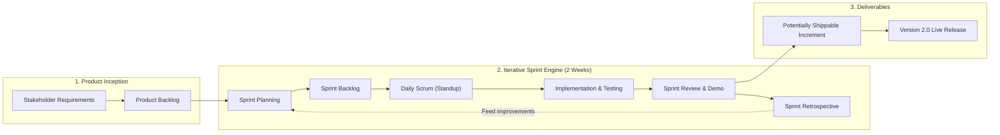

### Diagram 1.2: The 4 P's Management Model
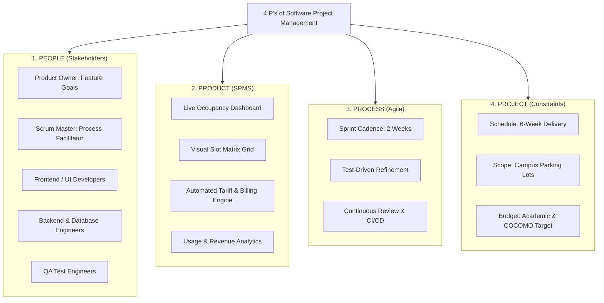

---

# UNIT 2: SOFTWARE REQUIREMENTS MODELS

### Diagram 2.1: System Use Case Diagram
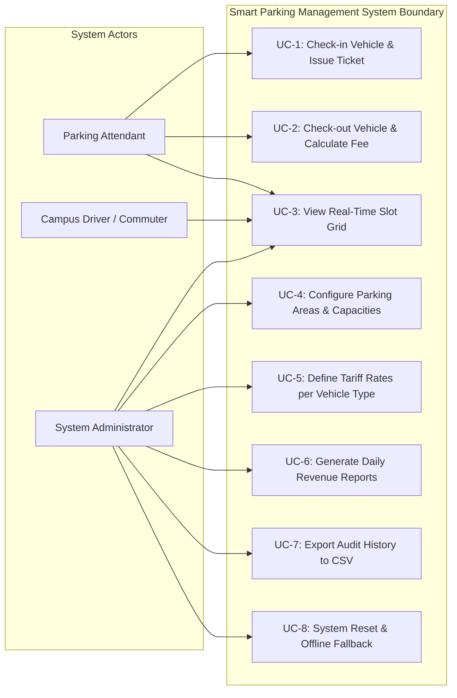

### Diagram 2.2: Activity Flow Diagram (Check-In & Check-Out Workflows)
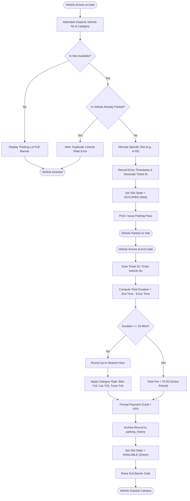

---

# UNIT 3: SOFTWARE DESIGN MODELS

### Diagram 3.1: 3-Tier Multi-Layer Architectural Model
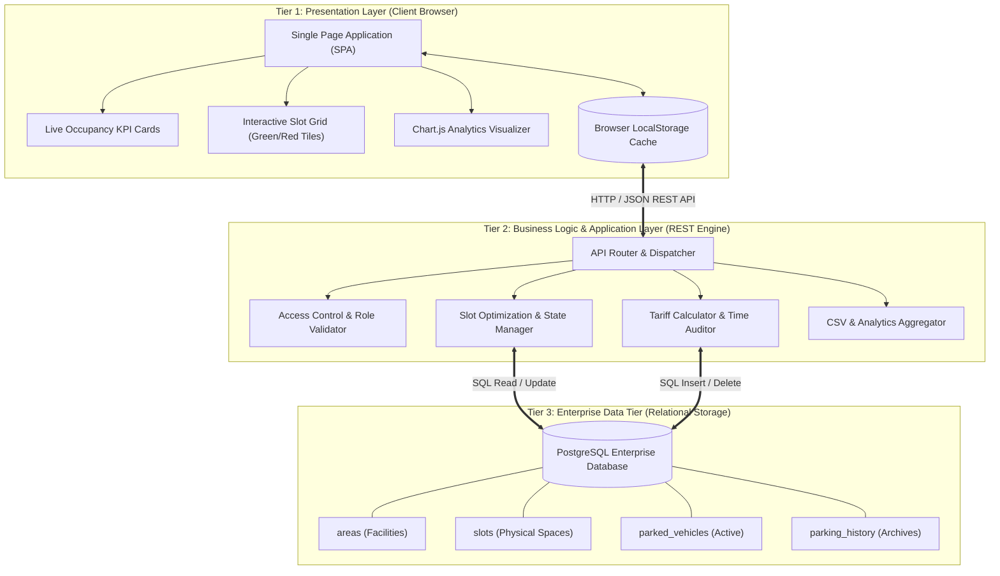

### Diagram 3.2: Component-Level Design Diagram
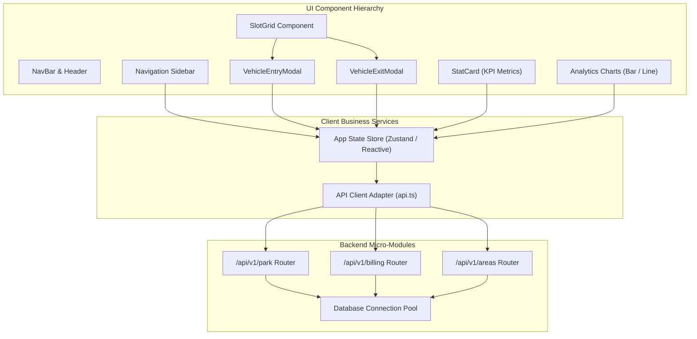

### Diagram 3.3: Class Diagram (Object-Oriented Design)
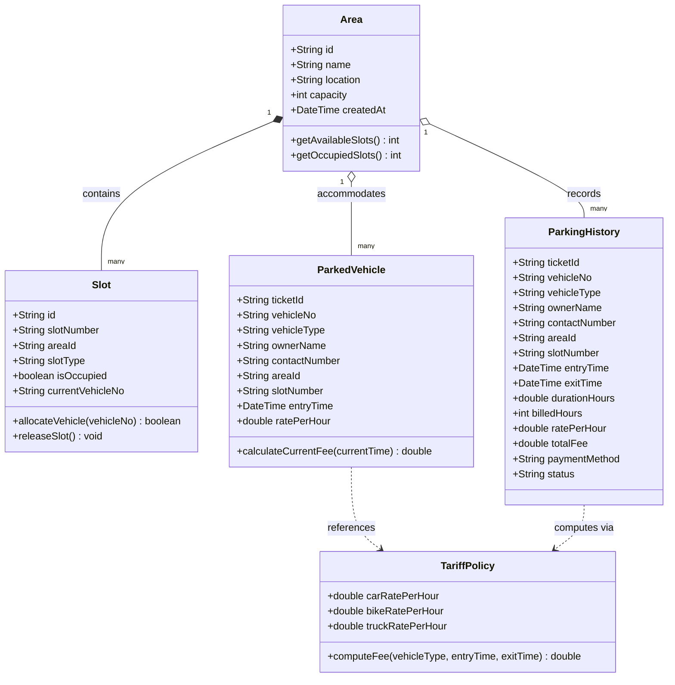

### Diagram 3.4: Sequence Diagram 1 — Vehicle Entry & Slot Allocation
```mermaid
sequenceDiagram
    autonumber
    actor Attendant as Parking Attendant
    participant UI as Web Frontend UI
    participant Service as Parking Service
    participant DB as PostgreSQL Database

    Attendant ->> UI: Selects Free Green Slot & Enters Vehicle No
    UI ->> Service: POST /api/v1/park (License, Type, Slot_ID, Area_ID)
    Service ->> DB: Query SELECT FROM parked_vehicles WHERE vehicle_no = License
    
    alt Vehicle Already Parked (Conflict)
        DB -->> Service: Duplicate Record Found
        Service -->> UI: 409 Conflict Error: "Vehicle already on site"
        UI -->> Attendant: Show Red Alert Modal
    else Vehicle Not Parked (Success)
        Service ->> DB: INSERT INTO parked_vehicles
        Service ->> DB: UPDATE slots SET is_occupied = TRUE WHERE id = Slot_ID
        DB -->> Service: Transaction Committed
        Service -->> UI: 201 Created (Ticket ID, Timestamp)
        UI -->> Attendant: Slot turns RED; Ticket Pass Printed
    end
```

### Diagram 3.5: Sequence Diagram 2 — Vehicle Exit & Billing Settlement
```mermaid
sequenceDiagram
    autonumber
    actor Attendant as Parking Attendant
    participant UI as Web Frontend UI
    participant Billing as Tariff Billing Engine
    participant DB as PostgreSQL Database

    Attendant ->> UI: Clicks Occupied Red Slot / Scans Ticket ID
    UI ->> Billing: calculateFee(entryTime, currentTime, vehicleType)
    Billing -->> UI: Returns Duration (e.g. 2.4 hrs), Billed (3 hrs), Total (₹60.00)
    UI -->> Attendant: Shows Billing Summary & Payment Dialog
    Attendant ->> UI: Selects Payment Mode (UPI / Cash) & Clicks "Confirm Exit"
    UI ->> DB: INSERT INTO parking_history (Ticket, Times, Fee, Method, Status)
    UI ->> DB: DELETE FROM parked_vehicles WHERE ticket_id = Ticket
    UI ->> DB: UPDATE slots SET is_occupied = FALSE, current_vehicle_no = NULL
    DB -->> UI: Transaction Committed Successfully
    UI -->> Attendant: Slot turns GREEN; Receipt Issued; Metrics Refreshed
```

### Diagram 3.6: Parking Slot State Transition Diagram
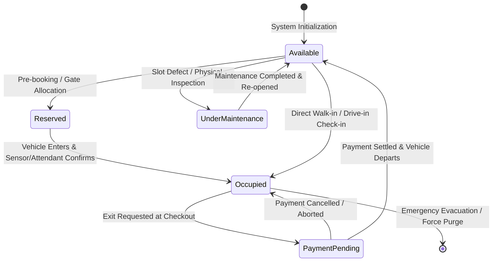

### Diagram 3.7: Relational Entity-Relationship (ER) Diagram
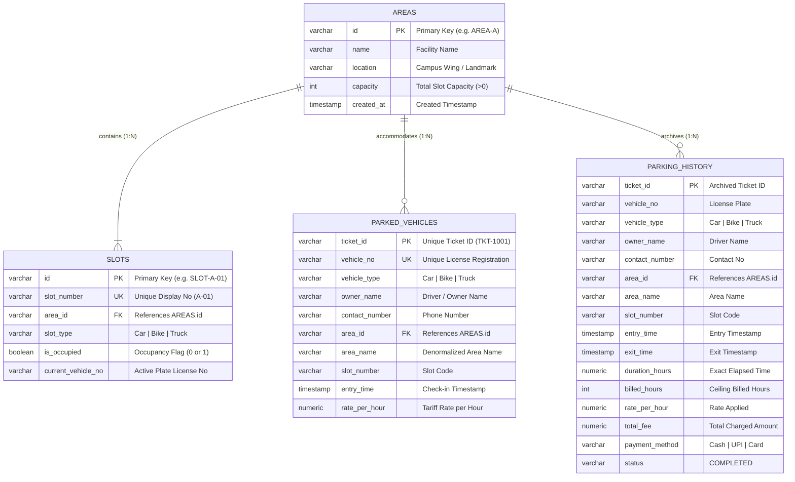

### Diagram 3.8: Physical Deployment Diagram
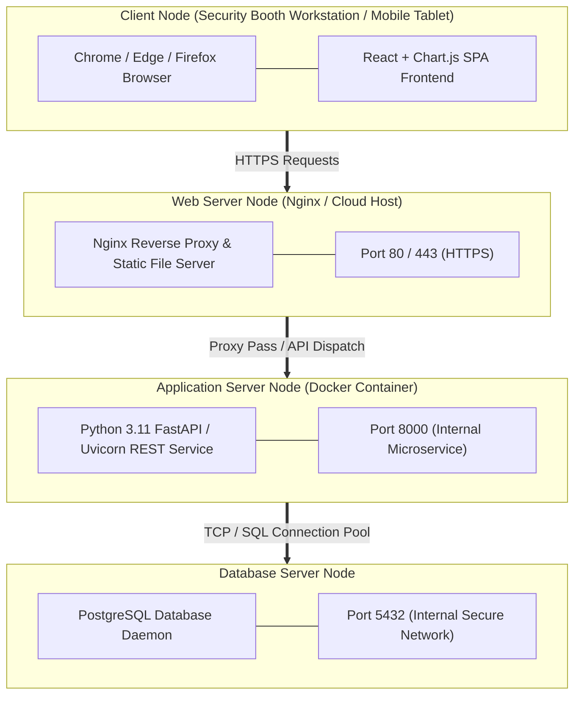

---

# UNIT 4: SOFTWARE TESTING MODELS

### Diagram 4.1: Software Engineering V-Model (V&V Mapping)
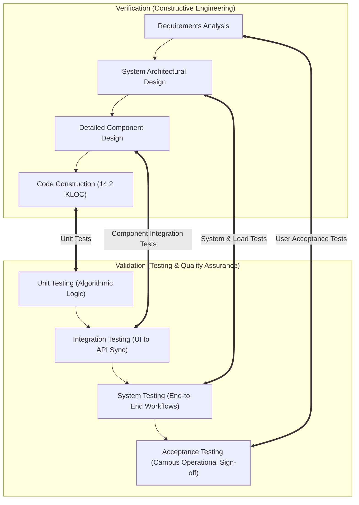

### Diagram 4.2: White Box Control Flow Graph (Basis Path Model)
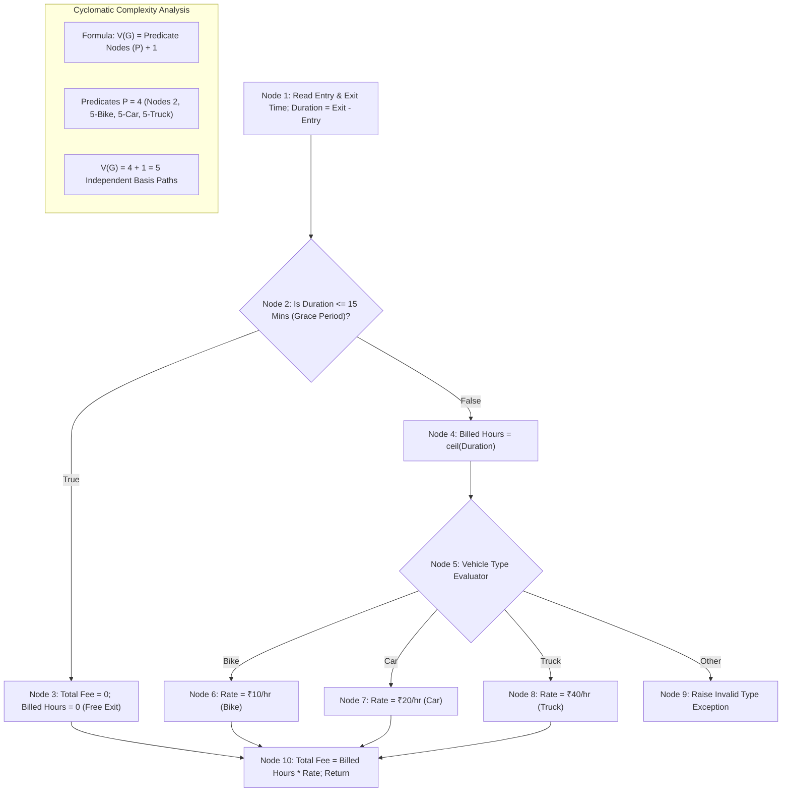

### Diagram 4.3: Black Box Equivalence Partitioning & Boundary Value Model
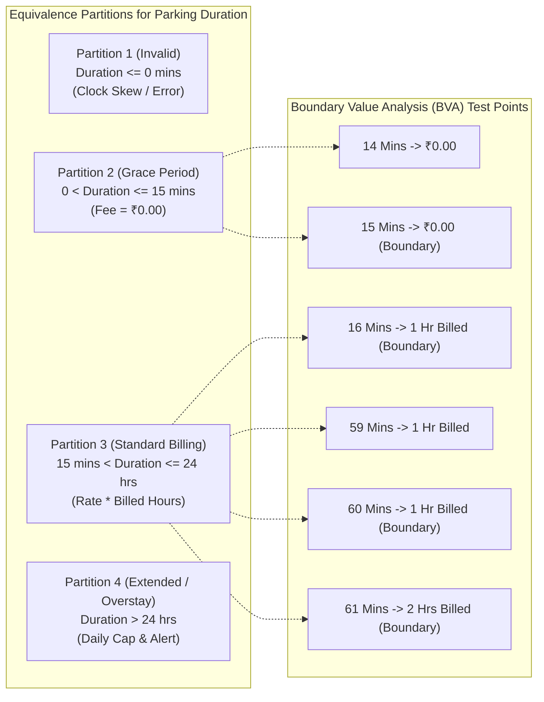

---

# UNIT 5: SOFTWARE PROJECT MANAGEMENT MODELS

### Diagram 5.1: Work Breakdown Structure (WBS)
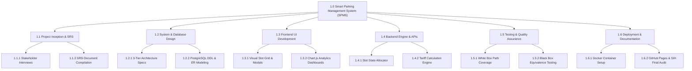

### Diagram 5.2: Project Sprint Schedule & Timeline
```mermaid
flowchart LR
    subgraph Sprint1["Sprint 1 (Days 1 - 10)"]
        T1["Requirements Elicitation"] --> T2["SRS Definition"]
        T2 --> T3["Relational ER Schema Design"]
    end

    subgraph Sprint2["Sprint 2 (Days 11 - 22)"]
        T4["Interactive Slot Grid UI"] --> T5["Entry & Exit Modals"]
        T5 --> T6["Client State Store & LocalStorage"]
    end

    subgraph Sprint3["Sprint 3 (Days 23 - 34)"]
        T7["Tariff Calculation Engine"] --> T8["Chart.js Analytics Dashboards"]
        T8 --> T9["CSV Audit Export Utility"]
    end

    subgraph Sprint4["Sprint 4 (Days 35 - 45)"]
        T10["PostgreSQL DB Integration"] --> T11["White & Black Box Test Suites"]
        T11 --> T12["Production Deployment & Evaluation"]
    end

    T3 --> T4
    T6 --> T7
    T9 --> T10
```

### Diagram 5.3: COCOMO Estimation Process & Metrics Model
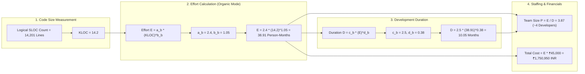

---
**Model Specification Status:** Verified and ready for visual presentation and viva defense under Course 25ITT33.
