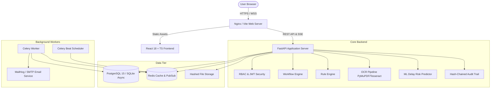

# ApprovalTrack System Architecture

## 1. Overview
ApprovalTrack is an enterprise-grade AICTE approval workflow automation, compliance monitoring, and alert management system built for the Smart India Hackathon 2026 (Problem Statement ID: SIH26262, Team: Tech Spark).

It eliminates manual coordination friction through:
1. **Automated Stage Progression Engine**: Stage transitions driven by SLA timelines and prerequisite satisfaction.
2. **Real-Time Pendency Dashboard**: Transparent tracking of pending files, responsible scrutiny officers, and delay metrics.
3. **Automated Document Expiry & OCR Pipeline**: Automated extraction of validity dates from land leases and fire NOCs with human-in-the-loop verification.
4. **Data-Driven Rule Engine**: Configurable compliance and workflow conditions evaluated without hardcoding.
5. **EVC Inspection Orchestration**: Availability checks, conflict-of-interest detection, structured digital reporting.
6. **Proactive Alerts & Escalation Ladder**: Multi-tier escalation notifying desk officers, senior officers, and regional heads.
7. **ML Delay Risk Scoring**: Scikit-Learn based predictive model alerting officers to high-risk delayed applications.
8. **Tamper-Evident Hash-Chained Audit Trail**: SHA-256 cryptographic chaining of all system events.

---

## 2. Component Diagram

---

## 3. Security & RBAC Scoping
- **Super Admin**: System governance, SLA configuration, user provisioning, global overrides.
- **AICTE Officer**: Portfolio-scoped scrutiny, document validation, deficiency issuance, EVC coordination.
- **Senior Officer**: Regional supervisor, escalation handling, stage transition approvals, officer reassignments.
- **EVC Member**: External expert panel, conflict-screened visit assignments, structured inspection reporting.
- **College Admin**: Institution-scoped portal, multi-step application drafting, evidence submission, deadline tracking.
- **Auditor**: Read-only global visibility, hash-chain integrity verification, compliance analytics.

Data isolation is enforced at the database query layer (object-level authorization) across all API endpoints.

