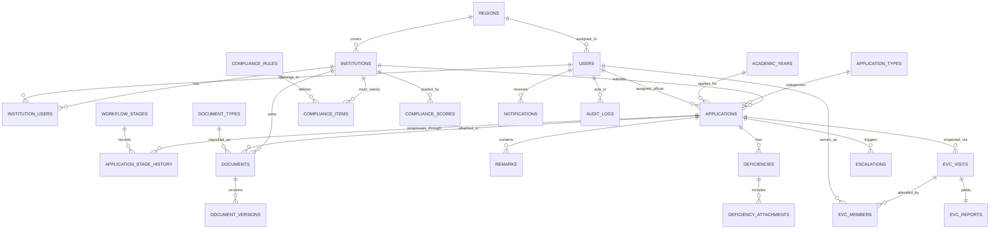

# Database Schema & Entity Relationships

The ApprovalTrack database schema is fully normalized and organized across 7 core functional domains.

---

## Key Table Structures

### 1. `users`
- `id` (UUID/Integer, PK)
- `name` (String, NOT NULL)
- `email` (String, UNIQUE, NOT NULL, INDEXED)
- `password_hash` (String, NOT NULL)
- `role` (Enum: SUPER_ADMIN, AICTE_OFFICER, SENIOR_OFFICER, EVC_MEMBER, COLLEGE_ADMIN, AUDITOR)
- `phone` (String, NULLABLE)
- `region_id` (FK -> regions.id, NULLABLE)
- `is_active` (Boolean, DEFAULT True)
- `created_at`, `updated_at` (Timestamp)

### 2. `institutions`
- `id` (UUID/Integer, PK)
- `name` (String, NOT NULL)
- `aicte_id` (String, UNIQUE, NOT NULL, e.g. "1-10972384")
- `type` (Enum: ENGINEERING, POLYTECHNIC, MANAGEMENT, PHARMACY, ARCHITECTURE)
- `address`, `state`, `district` (String)
- `region_id` (FK -> regions.id)
- `university_affiliation` (String)
- `trust_society_name` (String)
- `established_year` (Integer)
- `status` (Enum: ACTIVE, PROBATION, WITHDRAWN)

### 3. `applications`
- `id` (PK)
- `application_no` (String, UNIQUE, e.g. "APP-2026-00124")
- `institution_id` (FK -> institutions.id)
- `type_id` (FK -> application_types.id)
- `academic_year_id` (FK -> academic_years.id)
- `current_stage_id` (FK -> workflow_stages.id)
- `status` (Enum: DRAFT, SUBMITTED, UNDER_SCRUTINY, DEFICIENCY_RAISED, EVC_SCHEDULED, EVC_COMPLETED, APPROVED, APPROVED_WITH_CONDITIONS, REJECTED)
- `priority` (Enum: NORMAL, HIGH, URGENT)
- `assigned_officer_id` (FK -> users.id, NULLABLE)
- `submitted_at`, `due_at`, `completed_at` (Timestamp)
- `risk_score` (Float, 0.0 - 1.0)
- `risk_label` (Enum: LOW, MEDIUM, HIGH)
- `is_overdue` (Boolean, DEFAULT False)

### 4. `documents`
- `id` (PK)
- `application_id` (FK -> applications.id, NULLABLE)
- `institution_id` (FK -> institutions.id)
- `type_id` (FK -> document_types.id)
- `file_path`, `original_name`, `mime`, `size` (Integer)
- `sha256` (String, 64 hex characters)
- `status` (Enum: UPLOADED, OCR_PENDING, OCR_DONE, VERIFIED, REJECTED, EXPIRED)
- `issue_date`, `expiry_date` (Date, NULLABLE)
- `ocr_text` (Text)
- `ocr_confidence` (Float)
- `extracted_fields` (JSON)
- `verified_by` (FK -> users.id, NULLABLE), `verified_at` (Timestamp)

### 5. `audit_logs` (Append-Only Hash Chain)
- `id` (PK)
- `actor_id` (FK -> users.id, NULLABLE)
- `actor_role` (String)
- `action` (String, NOT NULL)
- `entity_type` (String, NOT NULL)
- `entity_id` (String, NOT NULL)
- `before_state` (JSON)
- `after_state` (JSON)
- `ip_address` (String)
- `user_agent` (String)
- `prev_hash` (String, 64 hex characters)
- `hash` (String, 64 hex characters)
- `created_at` (Timestamp, NOT NULL)

